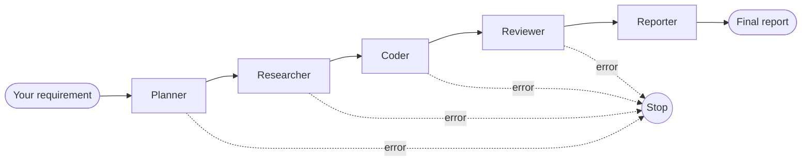
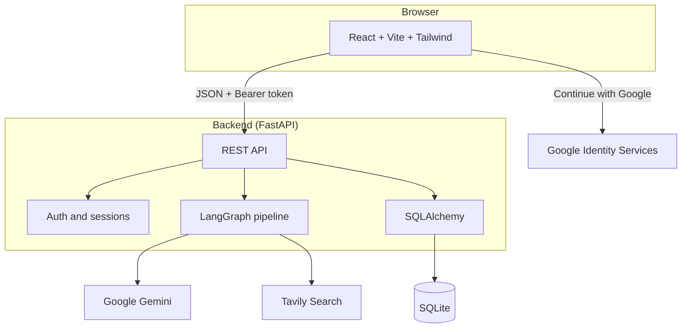

<div align="center">

# Meivn — Multi-Agent Dev Platform

**Turn a plain-English software requirement into a planned, researched, coded, reviewed and documented solution — using a team of five specialized AI agents.**


</div>

---

## Table of Contents

- [Overview](#overview)
- [Screenshots](#screenshots)
- [Features](#features)
- [How It Works](#how-it-works)
- [Architecture](#architecture)
- [Tech Stack](#tech-stack)
- [Project Structure](#project-structure)
- [Getting Started](#getting-started)
- [Environment Variables](#environment-variables)
- [Using the Platform](#using-the-platform)
- [API Reference](#api-reference)
- [Authentication & Data Isolation](#authentication--data-isolation)
- [Reliability](#reliability)
- [Troubleshooting](#troubleshooting)
- [Limitations & Future Scope](#limitations--future-scope)


---

## 🚀 Overview

Asking a single AI model to understand a request, research it, write the code and check its own work in one pass leads to shallow answers that are hard to debug. **meivn** takes the approach of a real software team instead: the work is split across **five specialized agents**, each with exactly one responsibility, passing their results along through a shared state.

You describe what you want to build, for example *"Build a spam email detector"*, and watch each agent work in real time. You get back a structured final report containing the plan, the research findings, the generated code, the review notes, and a **corrected final version of the code with the reviewer's fixes applied**.

Every account has its own private workspace: its own projects, dashboard statistics and settings.

## Screenshots

| Landing page | 

 

## ✨ Features

**Multi-agent workflow**
- Five single-purpose agents: **Planner → Researcher → Coder → Reviewer → Reporter**
- Orchestrated with **LangGraph** using a typed shared state
- Live **web research** through the Tavily Search API (optional; falls back to the model's own knowledge)
- **Live progress screen**: each agent moves from *Waiting → Running → Completed* while you watch
- **Final report** with Summary, Plan, Research Findings, Generated Code, Review Notes and **Final Code (Updated)**
- Fail-fast behaviour: if any agent fails, the workflow stops cleanly and the failure is shown on that agent
- Re-run a project, view the report in the app, or download it as a `.txt` file

**Accounts and projects**
- Sign up / sign in with **email and password** or **Google Sign-In**
- Sign-in is required to use the platform; every account has **its own projects**
- A new account starts with **0 projects** and an empty Projects page
- Random username assigned at sign-up, editable later in Settings
- Dashboard with live project and completed-task counts and your four most recent projects
- Projects page with status, a live "time ago" label, **Open** and **Delete**

**Settings** (everything is saved per account)
- **Account**: name, username, email, delete account
- **Appearance**: light/dark theme, accent colour, font size, animations (applied instantly)
- **Privacy & Data**: preferences, export all your data as JSON, delete your projects
- **Security**: change password, active sessions, login history, revoke sessions, security preferences

**Quality of life**
- Automatic retry with exponential backoff when Gemini returns temporary `503` / `429` errors
- Markdown-rendered report with proper headings, lists and code blocks
- Responsive UI built with Tailwind CSS

## ⚙️ How It Works



| # | Agent | Reads | Produces |
|---|-------|-------|----------|
| 1 | **Planner** | your requirement | a numbered plan: what to research, build and review |
| 2 | **Researcher** | requirement, plan, live web results | summarized findings with sources |
| 3 | **Coder** | requirement, plan, research | production-ready code with setup notes |
| 4 | **Reviewer** | generated code | issues found and concrete fixes |
| 5 | **Reporter** | everything above | the final structured report, including the corrected final code |

All agents share one typed state object (`AgentState`). Each agent reads the fields it needs and writes only its own output. If an agent raises an error, the graph stops and the error is stored against that step, so you always know exactly where something went wrong.

When you submit a project, the backend creates a task and runs the pipeline in a **background thread**. The frontend polls the task every couple of seconds and updates each agent's status until the report is ready.

## 🏗️ Architecture



## 🛠️ Tech Stack

| Layer | Technology |
|-------|-----------|
| **Frontend** | React 18, React Router 6, Vite 5, Tailwind CSS 3, Font Awesome |
| **Backend** | Python 3.10+, FastAPI, Uvicorn, Pydantic 2 |
| **AI orchestration** | LangGraph, LangChain, `langchain-google-genai` |
| **LLM** | Google Gemini |
| **Web research** | Tavily Search API |
| **Database** | SQLite via SQLAlchemy 2 ORM |
| **Auth & security** | PBKDF2-HMAC-SHA256 password hashing, HMAC-signed session tokens, Google Identity Services |
| **Config** | python-dotenv (`.env` files) |

## Project Structure

```
meivn/
├── backend/
│   ├── app/
│   │   ├── agents/            # planner, researcher, coder, reviewer, reporter
│   │   ├── workflows/         # state.py (shared state), graph.py (LangGraph pipeline)
│   │   ├── tools/             # llm.py (Gemini client + retry), web_search.py (Tavily)
│   │   ├── routers/           # auth.py, tasks.py, settings.py, memory.py
│   │   ├── models.py          # SQLAlchemy models (User, SessionLog, Task, AgentStep)
│   │   ├── schemas.py         # Pydantic request/response schemas
│   │   ├── security.py        # password hashing + signed session tokens
│   │   ├── task_runner.py     # runs the pipeline and records each step
│   │   ├── database.py        # engine, sessions, table creation
│   │   ├── config.py          # environment-based settings
│   │   └── main.py            # FastAPI app, CORS, routers
│   ├── requirements.txt
│   └── .env.example
├── frontend/
│   ├── src/
│   │   ├── components/        # pages/, auth/, common/ (Navbar, Sidebar, Layout)
│   │   ├── context/           # AppContext, AuthContext
│   │   ├── hooks/             # useAuth, useWorkflow
│   │   ├── services/          # api.js (all backend calls)
│   │   ├── utils/             # appearance.js, googleAuth.js
│   │   └── App.jsx            # routes + sign-in guard
│   ├── package.json
│   └── .env.example
├── docs/screenshots/          # images used in this README
└── README.md
```

## 🚀 Getting Started

### Prerequisites

- **Python 3.10+** and **pip**
- **Node.js 18+** and **npm**
- A **Google Gemini API key**: [aistudio.google.com/app/apikey](https://aistudio.google.com/app/apikey)
- *(Optional)* a **Tavily API key** for live web research: [tavily.com](https://tavily.com)
- *(Optional)* a **Google OAuth Client ID** for "Continue with Google" (see [below](#setting-up-google-sign-in))

### 1. Clone the repository

```bash
git clone https://github.com/<your-username>/meivn.git
cd meivn
```

### 2. Backend

```bash
cd backend

# create and activate a virtual environment
python -m venv venv
venv\Scripts\activate            # Windows
# source venv/bin/activate       # macOS / Linux

pip install -r requirements.txt

# create your own .env from the template, then fill in your keys
copy .env.example .env           # Windows
# cp .env.example .env           # macOS / Linux

uvicorn app.main:app --reload --port 8000
```

The API is now running at **http://localhost:8000**, with interactive docs at **http://localhost:8000/docs**. The SQLite database file (`multi_agent.db`) and all tables are created automatically on first start.

### 3. Frontend

Open a **second terminal**:

```bash
cd frontend
npm install

copy .env.example .env           # Windows
# cp .env.example .env           # macOS / Linux

npm run dev
```

The app opens at **http://localhost:3000**.

> Keep **both** terminals running while you use the app. If the backend isn't running, the frontend shows "Failed to fetch".

### Setting up Google Sign-In

Email/password sign-up works without this. To enable the **Continue with Google** button:

1. Go to [Google Cloud Console → Credentials](https://console.cloud.google.com/apis/credentials) and create an **OAuth client ID** of type **Web application**.
2. Under **Authorized JavaScript origins**, add the exact address your frontend runs on: `http://localhost:3000`.
3. Put the Client ID in **both** `backend/.env` (`GOOGLE_CLIENT_ID`) and `frontend/.env` (`VITE_GOOGLE_CLIENT_ID`). It must be the same value.
4. Restart both servers.

## Environment Variables

**`backend/.env`**

| Variable | Required | Description |
|----------|:--------:|-------------|
| `GOOGLE_API_KEY` | Yes | Gemini API key used by every agent |
| `TAVILY_API_KEY` | No | Enables live web research. Without it the Researcher relies on the model's own knowledge |
| `GEMINI_MODEL` | Yes | Gemini model name, e.g. `gemini-3.5-flash` |
| `DATABASE_URL` | Yes | SQLite connection string, e.g. `sqlite:///./multi_agent.db` |
| `FRONTEND_ORIGIN` | Yes | Frontend address allowed by CORS, e.g. `http://localhost:3000` |
| `SECRET_KEY` | Yes | Long random string used to sign session tokens. **Change it.** Generate one with `python -c "import secrets; print(secrets.token_hex(32))"` |
| `TOKEN_TTL_DAYS` | No | Session token lifetime in days |
| `GOOGLE_CLIENT_ID` | No | OAuth Client ID for Google Sign-In |
| `LEGACY_PROJECTS_OWNER_EMAIL` | No | Attaches projects created before accounts owned their projects to this account on its next sign-in |
| `APP_ENV`, `LOG_LEVEL` | No | Environment name and log level |

**`frontend/.env`**

| Variable | Required | Description |
|----------|:--------:|-------------|
| `VITE_API_URL` | Yes | Backend address, e.g. `http://localhost:8000` |
| `VITE_GOOGLE_CLIENT_ID` | No | Same Client ID as the backend's `GOOGLE_CLIENT_ID` |

> **Never commit your `.env` files.** They contain secret keys. Only the `.env.example` templates belong in the repository.

## Using the Platform

1. Open the landing page and click **Launch Platform**. If you aren't signed in you'll be taken to **Sign In / Sign Up**.
2. **Sign up** with your name, email and password (or continue with Google). You land on your **Dashboard**.
3. Click **New Project**, describe what you want to build, or pick one of the example prompts, and start the workflow.
4. Watch the five agents work on the **Workflow** screen.
5. When it completes, click **View Output** to read the report, **Download Output** to save it, or **Run Again** to regenerate.
6. Find every project later under **Projects**, where you can reopen or delete it.
7. Tune your account, theme and privacy options under **Settings**.

> Sign-in lasts for the browser tab. Refreshing keeps you signed in, but opening the site again later asks you to sign in again.

## API Reference

All platform endpoints require an `Authorization: Bearer <token>` header (returned by sign-in/sign-up). Full interactive documentation is available at `/docs` while the backend is running.

| Method | Endpoint | Description |
|--------|----------|-------------|
| `GET` | `/api/health` | Health check |
| `POST` | `/api/auth/signup` | Create an account, returns a token and the user |
| `POST` | `/api/auth/login` | Sign in with email and password |
| `POST` | `/api/auth/google` | Sign in / sign up with a Google credential |
| `GET` | `/api/auth/me` | The currently signed-in user |
| `POST` | `/api/auth/logout` | End the current session |
| `POST` | `/api/tasks` | Submit a requirement and start the pipeline |
| `GET` | `/api/tasks` | List **your** projects |
| `GET` | `/api/tasks/{id}` | One project with per-agent status and the final report |
| `DELETE` | `/api/tasks/{id}` | Delete one of your projects |
| `GET` `PATCH` | `/api/settings/account` · `/appearance` · `/privacy` · `/security` | Read / update settings |
| `POST` | `/api/settings/account/change-password` | Change your password |
| `GET` | `/api/settings/privacy/export` | Export all of your data as JSON |
| `DELETE` | `/api/settings/privacy/conversations` | Delete all of your projects |
| `GET` `DELETE` | `/api/settings/security/sessions` · `/login-history` | List and revoke sessions |
| `DELETE` | `/api/settings/account` | Delete your account and its data |

## 🔐 Authentication & Data Isolation

- Passwords are hashed with **PBKDF2-HMAC-SHA256** and a unique random salt; plain-text passwords are never stored.
- Sessions use **HMAC-signed tokens**, and each sign-in is recorded as a session you can see and revoke in **Settings → Security**.
- The token is kept in the browser's `sessionStorage`, so it is cleared when the tab is closed.
- **Every project, setting and session belongs to one account.** The API filters by the signed-in user on every request, so one account can never list, open or delete another account's projects. Asking for someone else's project returns *not found*.
- A new account starts completely empty.

## 🛡️ Reliability

- **LLM retries:** temporary Gemini errors (`503` model overloaded, `429` rate limit) are retried automatically with exponential backoff; other errors fail immediately.
- **Fail-fast pipeline:** if an agent fails, the workflow stops and the exact error is stored on that step instead of continuing with bad input.
- **Background execution:** long-running pipelines never block the API.
- **Graceful research:** if Tavily is unavailable or unconfigured, the Researcher continues without web results.

## Troubleshooting

| Problem | Likely cause and fix |
|---------|---------------------|
| **"Failed to fetch"** on sign-in or anywhere else | The backend isn't running or crashed. Start it with `uvicorn app.main:app --reload --port 8000` and read its terminal for the real error |
| Google button: **`origin_mismatch`** | `http://localhost:3000` isn't listed under *Authorized JavaScript origins* for your OAuth client |
| Google button does nothing | `GOOGLE_CLIENT_ID` / `VITE_GOOGLE_CLIENT_ID` missing or different. Fix both, restart both servers |
| Backend error: **`no such column: ...`** | Your `multi_agent.db` was created by an older version of the code. Add the missing column with `ALTER TABLE`. Deleting the database also works but **erases all data** |
| An agent shows **Failed** with `503 UNAVAILABLE` | Gemini was temporarily overloaded. Retry is automatic, but if it still fails, run the project again |
| `Fatal error in launcher: Unable to create process` | The virtual environment was copied from another folder. Delete `venv`, run `python -m venv venv` again and reinstall requirements |
| `pip install` hangs or fails with DNS errors | Temporary network problem. Re-run the command or switch network |

## 🔮 Limitations & Future Scope

**Current limitations**
- The system **does not execute** the generated code; it only produces it (this avoids running untrusted AI-written code).
- Output quality depends on the underlying Gemini model.
- SQLite is used for simplicity and is suited to a single-machine deployment.
- Google sign-in credentials are decoded but not cryptographically verified against Google's public keys; this is fine for local use but should be hardened before production.
- **Forgot password** is interface-only, and the **2FA / passkey** toggles store a preference without enforcing it.
- There is no automated test suite and no deployment configuration yet.

**Future scope**
- A Coder ↔ Reviewer feedback loop that automatically revises code until the reviewer approves (with a bounded retry count)
- Sandboxed execution and automatic testing of generated code
- Verify Google tokens server-side and add real password reset / 2FA
- PostgreSQL, Docker and CI/CD for deployment
- Support for more LLM providers and downloadable project scaffolds (ZIP)
- Team workspaces and shared projects


<div align="center">


</div>
